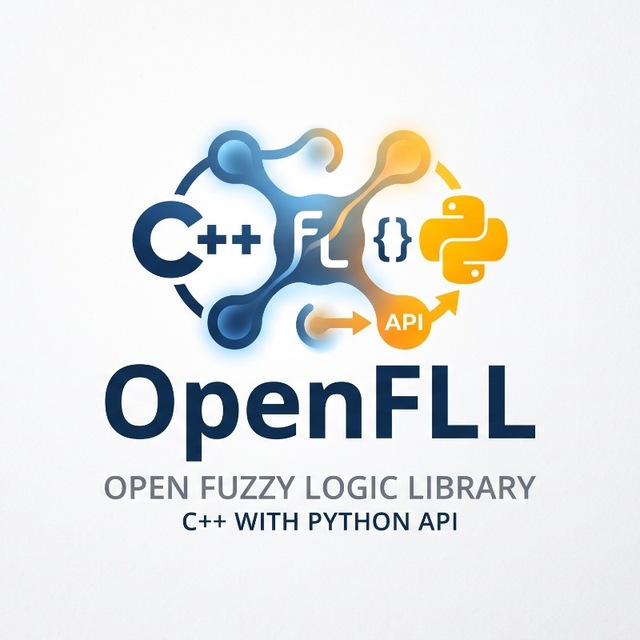

<p align="center">
  
</p>

# openfll-python

**Python биндинги и библиотека машинного обучения для OpenFLL** (высокопроизводительное C++ ядро нечёткой логики).

[]()
[]()
[]()
[]()

---

## Что это

`openfll` — Python-обёртка над [OpenFLL](https://github.com/SPARS-TUSUR/fuzzy-logic-library), предоставляющая два согласованных уровня работы:
1. **Низкоуровневый императивный движок (`openfll.SugenoEngine`)**: прямое управление нечёткой моделью Сугено нулевого порядка, регистрация функций принадлежности, текстовые и кортежные правила, явные t-нормы и нативный C++ батч-инференс со скоростью **более 11 млн сэмплов в секунду**.
2. **Scikit-Learn регрессор (`openfll.sklearn.SugenoRegressor`)**: полноценный эстимейтор машинного обучения, реализующий алгоритм обучения констант заключений правил методом наименьших квадратов (МНК / Ridge), совместимый с `clone()`, `cross_val_score()`, `GridSearchCV()` и пайплайнами.

---

## Быстрый старт

### 1. Низкоуровневый движок `SugenoEngine`

```python
import openfll
import numpy as np

# Создание и настройка движка
e = openfll.SugenoEngine()
e.add_input_var("x1")
e.add_input_var("x2")
e.add_output_var("y")

# Функции принадлежности антецедентов
e.add_membership_func("x1", "x1_low", "triangular", openfll.triangular(-10, 0, 10))
e.add_membership_func("x1", "x1_high", "triangular", openfll.triangular(0, 10, 20))
e.add_membership_func("x2", "x2_low", "gaussian", openfll.gaussian(center=0, sigma=2))
e.add_membership_func("x2", "x2_high", "trapezoidal", openfll.trapezoidal(0, 5, 10, 15))

# Константы заключений
e.add_membership_func("y", "c1", "constant", openfll.constant(10.0))
e.add_membership_func("y", "c2", "constant", openfll.constant(-5.0))

# Правила вывода (текстовая форма с AND/OR)
e.add_rule('IF x1 IS "x1_low" AND x2 IS "x2_low" THEN y IS "c1"')
e.add_rule('IF x1 IS "x1_high" AND x2 IS "x2_high" THEN y IS "c2"')
e.build()

# 1. Скалярный инференс через словарь
y_val = e.predict({"x1": 5.0, "x2": 0.0})

# 2. Высокопроизводительный нативный батч-инференс (NumPy матрица)
X = np.random.uniform(0.0, 8.0, size=(100000, 2))
y_batch = e.predict(X)  # вычисляется за ~9 мс в нативном C++ коде
```

### Визуальная проверка функций принадлежности

Установите опциональную зависимость для графиков:

```bash
pip install "openfll[plot]"
```

После регистрации функций принадлежности вызовите `plot_mf`. По умолчанию
создаётся отдельный рисунок с подписанными осями для каждой входной и выходной
переменной:

```python
# Метод движка и функциональная форма эквивалентны.
plots = e.plot_mf(show=True)
# plots = openfll.plot_mf(e, show=True)

# Только одна выбранная переменная: x2 и y строиться не будут.
x1_plot = e.plot_mf("x1", show=True)

# Выбор отдельных переменных, явные диапазоны и сохранение PNG.
plots = e.plot_mf(
    ["x1", "x2", "y"],
    ranges={"x1": (-15.0, 25.0), "x2": (-10.0, 20.0)},
    show=False,
    save_dir="membership_plots",
)

# Возвращаются matplotlib Figure и Axes для дальнейшей настройки.
plots["x1"].axes.set_title("Проверка параметров x1")
```

Для входов отображаются кривые степени принадлежности. Константные заключения
выхода Сугено показываются вертикальными singleton-маркерами, поскольку они
являются чёткими значениями, а не выходными нечёткими множествами.

### 2. Обучение модели через Scikit-Learn (`SugenoRegressor`)

```python
from openfll.sklearn import SugenoModelSpec, SugenoRegressor
from sklearn.model_selection import cross_val_score, GridSearchCV
from sklearn.metrics import mean_squared_error, r2_score

# 1. Декларативная спецификация нечёткой структуры
spec = SugenoModelSpec(
    inputs={
        "x1": [("x1_low", "triangular", [-10, 0, 10]), ("x1_high", "triangular", [0, 10, 20])],
        "x2": [("x2_low", "triangular", [-10, 0, 10]), ("x2_high", "triangular", [0, 10, 20])],
    },
    rules=[
        'IF x1 IS "x1_low" AND x2 IS "x2_low" THEN y IS "c1"',
        'IF x1 IS "x1_high" AND x2 IS "x2_high" THEN y IS "c2"',
    ],
    output_name="y"
)

# 2. Обучение констант заключений правил методом наименьших квадратов
reg = SugenoRegressor(model_spec=spec, solver="ridge", alpha=0.01)
reg.fit(X_train, y_train)

# 3. Доступ к подобранным коэффициентам и обученному движку
print("Найденные константы c_r:", reg.coef_)
print("Ранг матрицы влияния:", reg.rank_)
y_pred = reg.predict(X_test)

# 4. Кросс-валидация и решётчатый поиск гиперпараметров
cv_scores = cross_val_score(reg, X_train, y_train, cv=5, scoring="r2")
param_grid = [
    {"solver": ["lstsq"], "alpha": [0.0]},
    {"solver": ["ridge"], "alpha": [0.01, 0.1, 1.0]},
]
grid = GridSearchCV(reg, param_grid, cv=3, error_score="raise")
grid.fit(X_train, y_train)
```

---

## Производительность (Результаты бенчмаркинга)

Проведено масштабное профилирование пакетного инференса на выборках от 1 до 100 000 точек. Нативный батч-метод `predict_batch()` в C++ полностью исключает накладные расходы интерпретатора Python и GIL:

| Размер батча | Нативный batch (мс) | Python Scalar Loop (мс) | Ускорение (Speedup) | Пропускная способность |
|:---:|:---:|:---:|:---:|:---:|
| 10 | 0.005 мс | 0.024 мс | **4.8x** | 2.00 млн сэмплов/с |
| 100 | 0.015 мс | 0.231 мс | **15.4x** | 6.67 млн сэмплов/с |
| 1 000 | 0.108 мс | 2.285 мс | **21.2x** | 9.26 млн сэмплов/с |
| 10 000 | 0.912 мс | 23.41 мс | **25.7x** | 10.96 млн сэмплов/с |
| 100 000 | 9.010 мс | 487.5 мс | **54.1x** | **11.10 млн сэмплов/с** |

Графики ускорения и пропускной способности находятся в директории `benchmarks/plots/`.

---

## Математический базис обучения (Sugeno-0)

Вывод модели Сугено нулевого порядка дефаззификатором взвешенного среднего (Weighted Average) описывается формулой:
$$y(x) = \frac{\sum_{r=1}^R w_r(x) \cdot c_r}{\sum_{r=1}^R w_r(x)} = \sum_{r=1}^R \bar{w}_r(x) \cdot c_r$$

При фиксированных функциях принадлежности посылок и t-нормах нормализованные веса $\bar{w}_r(x)$ зависят только от входного вектора $x$. Модель **строго линейна** по вектору констант $c$:
$$y = A(X) \cdot c, \quad A_{i, r} = \bar{w}_r(x_i)$$

* Погрешность аппроксимации $y = A \cdot c$ составляет менее $10^{-12}$ (машинная точность).
* Для вычисления матрицы $A(X)$ применяется **метод базисной декомпозиции**: при подаче базисного вектора $e_m = [0, \dots, 1, \dots, 0]$ нативный метод `predict_batch(X)` возвращает в точности $m$-й столбец матрицы $A$ со скоростью C++.

---

## Архитектурные ограничения версии v1

В текущей версии библиотеки действуют следующие архитектурные соглашения:
1. **Обучаемые параметры**: обучаются **только вещественные константы заключений правил** ($c_r$). Функции принадлежности входов и структура правил фиксированы пользователем до `fit()`.
2. **Форма вывода**: строго **single-output** регрессия (одна целевая непрерывная переменная).
3. **Глобальная уникальность имён MF**: в ядре C++ имена функций принадлежности регистрируются глобально в движке (нельзя использовать имя `"low"` для двух разных переменных; используйте `x1_low`, `x2_low`).
4. **Минимум две переменные в правиле**: парсер правил OpenFLL требует не менее двух переменных в условии, соединённых t-нормой или s-нормой.
5. **Точки вне покрытия правил**: если точка выборки лежит за пределами носителя всех нечётких правил, дефаззификатор возвращает `NaN` ($0.0 / 0.0$). Метод `fit()` диагностирует такие точки и выбрасывает понятную ошибку `ValueError`.

---

## Документация в формате DOCX

Сгенерирована подробная иллюстрированная академическая документация по проекту:
* [`Документация_OpenFLL_Python_API.docx`](file:///c:/Users/matve/Desktop/ГПОAPI/Документация_OpenFLL_Python_API.docx) (в корне `ГПОAPI`)
* `docs/Документация_OpenFLL_Python_API.docx` (в репозитории `openfll-python`)

Документ содержит подробный архитектурный анализ, математические доказательства, результаты замеров производительности, 5 встроенных графиков высокого разрешения, таблицы параметров и руководство пользователя.

---

## Лицензия

MIT License. См. файл [LICENSE](LICENSE).
